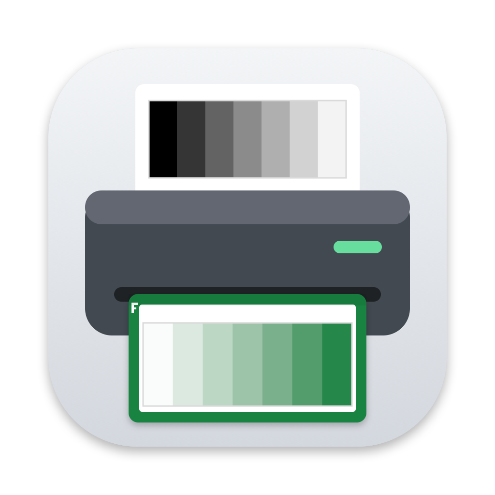

# OpenQuad

> [!WARNING]
> **Beta: work in progress.** OpenQuad 0.1.0 beta 3 is an early test release. It works on the
> hardware it was developed with (a Canon PIXMA MG3600 and its built-in scanner), but it hasn't been
> tried widely yet. Expect rough edges, and please
> [report what you find](https://github.com/akendrick/openquad/issues/new/choose).

Open-source black-and-white and toned inkjet printing, and digital negatives for carbon transfer, in
the spirit of QuadToneRIP. OpenQuad calibrates an ordinary inkjet printer with its own scanner so
greys print neutral and evenly spaced, adds optional duotone toning, and makes UV-blocking digital
negatives with process calibration (ChartThrob-style charts) for contact printing.

It comes as a **Mac app** (beta) and as a **Python command-line tool and desktop app**, which share
calibration files and settings.

## Download the beta (Mac app)

1. Download **OpenQuad-0.1.0b3.zip** (or the newest) from the
   [latest pre-release](https://github.com/akendrick/openquad/releases) and unzip it.
2. Move **OpenQuad.app** to your Applications folder.
3. The beta isn't notarized by Apple yet, so the first time you open it macOS will refuse. Open it
   anyway: double-click it once, then go to **System Settings ▸ Privacy & Security** and click
   **Open Anyway** next to OpenQuad. Or, in Terminal:
   `xattr -dr com.apple.quarantine /Applications/OpenQuad.app`

The first time you scan, macOS asks to let OpenQuad find devices on your local network: choose
**Allow** (it talks to your printer's scanner). If you chose Don't Allow, turn OpenQuad on in **System
Settings ▸ Privacy & Security ▸ Local Network**, then quit and reopen it.

Needs macOS 14 (Sonoma) or later, on Apple silicon or Intel. A short **How to Use OpenQuad** guide
opens on first launch (and later from **Help** or the **?** button).

### What to try

- **Print a photo:** open a photo, leave toning neutral or choose a duotone, and print through the
  macOS print panel or straight to a printer. Does the print match the preview, and come out at the
  size it says?
- **Calibrate your printer**, if it has a network (AirScan / eSCL) scanner: Calibrate This Printer…
  prints a test page, scans it and corrects colour casts and tone. How many rounds did it take, and
  did the goals get met?
- **Digital negatives:** make a negative and try the blocking test and process calibration, if you
  contact print (carbon, or another UV process).
- **Contact sheets:** the Contact Sheet tab (⌘3) puts up to 16 photos on one sheet, to print or
  to make a negative of.
- **Darkroom marks:** the guide line and registration marks (Darkroom marks, in the Print and
  Negative tabs and both calibration wizards). Can you see and line up a red or orange negative
  under your safelight?
- **Tabs:** Print, Negative, Contact Sheet, Printer Calibration and Process Calibration each keep
  their own work. Does moving between them while working feel natural?
- **The guide:** is anything unclear or missing?

### Reporting problems

Use the [beta feedback form](https://github.com/akendrick/openquad/issues/new?template=beta-feedback.yml).
Say which Mac, macOS version, printer and paper you used, and attach a screenshot or scan if it helps.
The app keeps its calibration runs, scans and measurements in
`~/Library/Application Support/OpenQuad`, which you can zip up and attach as well.

### Known limitations

- **Not notarized:** see the install steps above.
- **Tested hardware:** a Canon PIXMA MG3600 (Letter, plain paper) and its scanner; an Epson ET-2900's
  scanner works since beta 3 (its calibration is in progress). Other printers should work through the macOS print panel or CUPS. Scanning needs an eSCL scanner on the
  network; any scanner works through "Read a Scan File".
- **Print panel vs `lp`:** the Canon calibration was made printing straight to the printer (`lp`). A
  calibration made through the macOS print panel should be used through the panel (the wizard records
  which, and the app matches it).
- **Carbon:** the process calibration has been checked on simulated prints and the blocking test on
  real carbon prints, but not a full process calibration on real tissue yet.
- **QuadToneRIP-style raw-ink printing** (per-ink channels through Gutenprint) isn't built yet. The
  beta prints through the normal printer driver.

## Status

| Part | State |
| --- | --- |
| Mac app (SwiftUI): print window, toning, colour prints (colour-managed, soft-proof), digital negatives, print panel or direct printing | beta |
| Printer calibration wizard (grey balance, tone), calibration library per printer | beta, tested on Canon MG3600 |
| Blocking test and process calibration wizards (carbon) | beta, partly tested |
| Python CLI and desktop app (PySide6) | working; the reference implementation |
| Raw-ink QuadToneRIP-style path | not built |

Hardware results: [docs/hardware-tests.md](docs/hardware-tests.md). Calibration data from real prints
and scans: [calibration-data/](calibration-data/). Mac app details: [swift/README.md](swift/README.md).
Screenshots: [docs/screenshots/](docs/screenshots/).

## Python tools (command line and desktop app)

```bash
uv sync --extra ui
uv run openquad-app          # the PySide6 desktop app
uv run openquad --help       # the command line
```

### Usage

```bash
openquad target -o wedge.tif                       # 21-step greyscale wedge, 300 dpi
openquad presets                                   # list colour-layer presets
openquad composite photo.tif -o toned.tif --preset black-red
openquad printers                                  # CUPS printer names
openquad print toned.tif --printer Canon_MG3600_series --dry-run
openquad print photo.tif --printer Canon_MG3600_series --preset black-red
```

Grey balance for a colour inkjet (example: Canon MG3600 on plain paper):

```bash
openquad target --kind grey-balance -o gb.tif
openquad print gb.tif --printer Canon_MG3600_series
openquad scan --host 876298000000.local -o scan.jpg       # face down; Document mode by default
openquad measure scan.jpg -o m1.json
openquad greybalance m1.json -o canon-plain.oqcal --printer Canon_MG3600_series --paper "Letter plain"
openquad print photo.tif --printer Canon_MG3600_series --preset black-red --calibration canon-plain.oqcal
```

To check and refine, print a comparison page (uncorrected and corrected targets on one sheet), scan it
once, and measure both:

```bash
openquad target --kind comparison --calibration canon-plain.oqcal -o compare.tif
openquad measure scan2.jpg --pair --calibration canon-plain.oqcal -o m2.json
openquad greybalance m2-corrected.json -o canon-plain-v2.oqcal --shadow-damping 0.5
```

Once grey balance is good, even out the tone from the same kind of measurement:

```bash
openquad linearize m3-corrected.json --calibration canon-plain-v3.oqcal          # report only
openquad linearize m3-corrected.json --calibration canon-plain-v3.oqcal -o canon-plain-v4.oqcal
```
A calibration is only valid for the printer, paper and driver settings it was made with.

`print` prints at the file's real size (its DPI) on Letter paper by default; use `--paper`,
`--ppi`, `--copies` and `--option NAME=VALUE` (driver options) to change that.

### Digital negatives (carbon printing)

Print negatives on **inkjet-coated** transparency film (plain or laser film won't hold the ink):

```bash
openquad target --kind blocking -o blocking.tif      # 1. which ink colour blocks the UV?
openquad print blocking.tif --printer Canon_MG3600_series
#    expose it on carbon tissue at your usual time, make the print, scan it:
openquad scan --host 876298000000.local -o carbon.jpg
openquad blocking carbon.jpg                          #    -> which colours block, and their range
openquad negative photo.tif -o neg.tif --colour green --fit Letter   # 2. a negative in that colour
```

The orientation **F** in the safe edge prints in the carbon print: if it reads backwards, flip
`--mirror`.

Red and orange negatives are hard to see under a red safelight: `--guide` adds a black line round
the image and `--registration` adds targets and corner crop marks, all in black ink in the safe
edge (it blocks UV like the safe edge, so they don't print). Test sheets take `--size WxH` to fit
your tissue:

```bash
openquad negative photo.tif -o neg.tif --colour orange --fit Letter --guide --registration
openquad target --kind blocking --size 5x7 --guide -o blocking.tif
```

In the app, the Process Calibration tab does the same. **Calibration Wizard** takes you from the
blocking test to a finished curve one step at a time, with a button for each next step. **Advanced**
shows every setting at once. Test sheets print on the Negative tab's paper.

Then calibrate the process from a ChartThrob-style chart (after Kevin Bjorke's ChartThrob):

```bash
openquad target --kind chart --colour green -o chart.tif     # print on film, contact print, scan
openquad chart carbon-chart.jpg -o carbon.oqproc               # build the process curve
openquad target --kind chart --process carbon.oqproc -o chart2.tif   # check: print, scan, read
openquad chart carbon-chart2.jpg --process carbon.oqproc -o carbon-v2.oqproc
openquad negative photo.tif -o neg.tif --process carbon-v2.oqproc --fit Letter
```

The curve evens out patch-to-patch noise (`--smoothing none|light|medium|strong`, default
medium), and the report warns when tones are lost: highlights printing as paper white or shadows
as full black, which no curve can bring back. To make negatives in other software, as with
ChartThrob, export the curve, apply it to the greyscale photo there and invert:

```bash
openquad curve carbon-v2.oqproc carbon.acv       # Photoshop Curves (up to 16 points)
openquad curve carbon-v2.oqproc carbon.amp       # Photoshop arbitrary map (exact, 256 levels)
openquad curve carbon-v2.oqproc carbon.cube      # 3D LUT; or .csv for the 257 levels
openquad curve carbon-v2.oqproc curved.tif --image photo.tif   # the photo with the curve applied
```

Some processes (gum bichromate, multi-coat cyanotype) build their tones up in several coats,
each exposed under its own negative. `--separations N` splits the photo by tone into N negatives
(up to 6), from the lightest band to the darkest: each prints nothing in tones lighter than its
band and full strength in darker ones, so the coats add up to the photo. Set where the bands meet
with `--splits`, counted on a `--steps` scale (default 30), and blend the seams with `--overlap`.
Each negative can have its own curve. With `--registration` the targets are cut clear and each
negative is numbered, so the first coat records them on the paper to line the others up on:

```bash
openquad negative photo.tif -o gum.tif --process gum.oqproc --registration \
    --separations 3 --splits 10,20 --overlap 1 --layer-process 3=gum-shadows.oqproc
#    -> gum-1of3.tif (steps 0-10), gum-2of3.tif (10-20), gum-3of3.tif (20-30)
```

Test the split first with the step test, laid out like a contact-printed step tablet: tall
steps 0 to the step scale's end, each numbered sideways inside it, over a continuous gradient
lined up with them, in a black frame, so each coat's band, the seams between bands and any
banding all show. Print every negative of it in register, then move the splits to where the
print needs them:

```bash
openquad target --kind steps --steps 30 -o steps.tif
openquad negative steps.tif -o steps-neg.tif --process gum.oqproc --registration \
    --separations 3 --splits 10,20 --overlap 1
```

Each coat's own process curve linearises that coat alone; how the coats add up on the paper is
calibrated next, with the whole stack treated as one process. Print the process chart (as a
photo) through every negative onto one sheet, scan the finished print, and read it with
`openquad chart`: the result is a **coats curve**, applied to the photo before it is split. Read a
second print through it to check or refine:

```bash
openquad target --kind chart-photo -o chart.tif
openquad negative chart.tif -o chart-neg.tif --process gum.oqproc --registration \
    --separations 3 --splits 10,20 --overlap 1
#    print chart-neg-1of3.tif, -2of3, -3of3 in register on one sheet, scan the print:
openquad chart stacked.jpg -o coats.oqproc
openquad negative photo.tif -o gum.tif --process gum.oqproc --registration \
    --separations 3 --splits 10,20 --overlap 1 --coats-curve coats.oqproc
```

The app has the same under the Negative tab's Options ▸ Separations: a diagram of the bands, "Use
Step Test as Photo", and for the coats "Use Chart as Photo", "Read Chart Scan…" and the coats curve.
Every curve chooser lists the curves OpenQuad already has (saved setups, the latest round of each
process calibration, coats curves) as well as Other File…. "Preview all coats together" shows each coat
in its own colour on the photo, and a saved setup keeps the whole separation with its curves.

Split by **Colours** instead, and a colour photo becomes one negative per coat of a coloured pigment
(tricolour gum, cyanotype under gum): 2-4 coats, each given the colour it prints at full strength
(pigment presets or a colour well), in print order. Each pixel's colour is matched by the stack of
coats closest to it in density (coats add like filters), and a saturation slider (0-2) strengthens
the photo's colours before the split, for processes that print duller than the photo. "Preview the
print" shows the coats stacked in their colours. The Python core has the same
(`openquad.colour_separations`, `PrintSession.set_colour_separation`).

### Contact sheets

Up to 16 photos as thumbnails on one greyscale sheet, which then prints like any photo (or becomes a
negative):

```bash
openquad contact-sheet frames/*.tif -o sheet.tif --size 7.5x10 --wedge --labels
openquad negative sheet.tif -o sheet-neg.tif --colour green --fit Letter
```

`--background white`, `--crop` (fill every cell) and `--gap INCHES` change the layout.

## Development

```bash
uv sync
uv run pytest
uv run ruff check . && uv run mypy
uv run pre-commit install --hook-type pre-commit --hook-type pre-push
swift test --package-path swift/OpenQuadCore     # the Swift core, checked against Python
swift test --package-path swift/OpenQuadApp      # the Mac app
swift/sign-app.sh                                # build swift/build/OpenQuad.app
```

The Swift core is matched against the Python reference with test vectors
(`scripts/export_swift_vectors.py`); CI runs both on every push.

## Licence

GPL-2.0-or-later. See [LICENSE](LICENSE). OpenQuad is not affiliated with QuadToneRIP.
